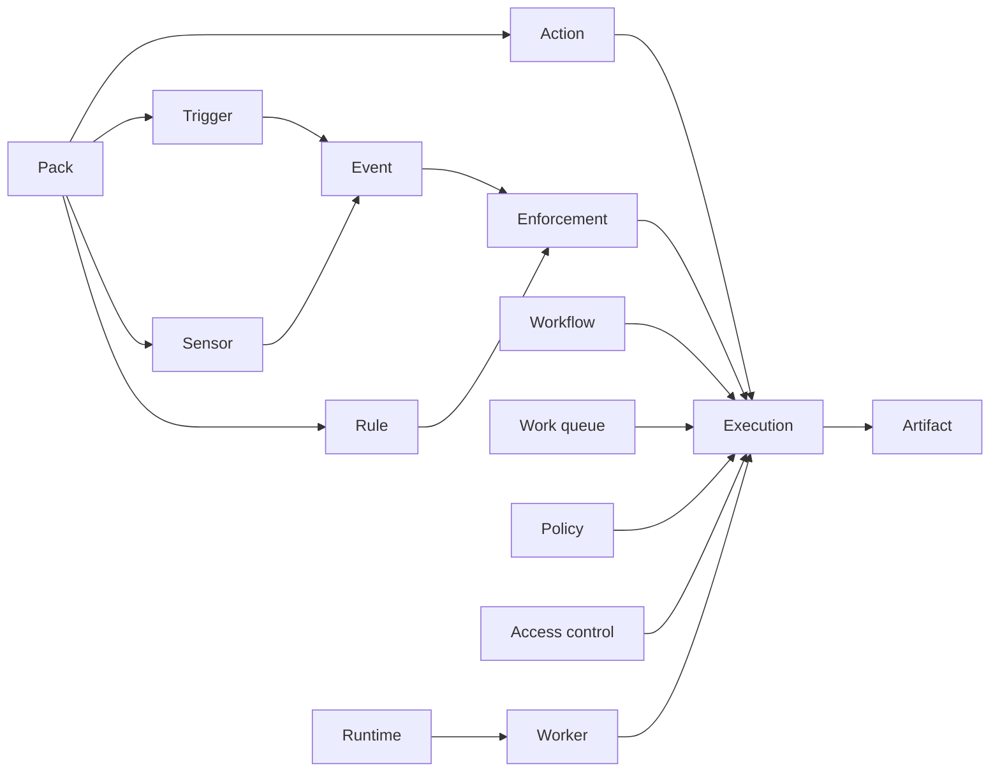

The data pages follow concepts exposed in the web client or CLI. Supporting tables stay with the concept they implement, so artifact versions belong to Artifacts and cache generations belong to Data caches.

## Primary relationship map

## Common representation rules

- Attune requires stock PostgreSQL 16+. Compose and CI use PostgreSQL 18; no TimescaleDB extension is required.
- Primary IDs are PostgreSQL `BIGINT` values represented as Rust `i64` values.
- `event`, `execution_history`, and `audit_event` are native daily UTC RANGE-partitioned parents on `created`, `time`, and `created`, each with a DEFAULT partition. Event and audit primary keys are `(id, created)` and do not enforce global uniqueness of `id` alone.
- `execution`, `enforcement`, `worker_history`, and `sensor_process_history` remain ordinary tables. History records have no public history-ID contract.
- Stable refs such as `core.echo` often remain beside nullable numeric relationships so retained operational records still identify deleted definitions.
- Packs own most authored definitions.
- Attune schemas use a flat per-field format, not raw JSON Schema.
- `event`, `enforcement`, and `execution` are treated as retention-sensitive operational records. References to them may be plain `BIGINT` values and may dangle after retention.
- Mutable execution and worker state has trigger-maintained history.
- JSONB stores authored schemas, placement rules, snapshots, parameters, results, and other shapes that do not merit separate relational tables.

The diagram shows conceptual relationships, not a map of foreign-key constraints. The [PostgreSQL-only contract](https://github.com/attune-system/attune/blob/main/docs/deployment/postgresql-only.md) and [migrations](https://github.com/attune-system/attune/tree/main/migrations) define current partitioning and retention behavior. The historical migration filename `20250101000009_timescaledb_history.sql` now defines PostgreSQL history tables, triggers, and ordinary hourly views; it does not require TimescaleDB.

## Page groups

| Group | Concepts |
| --- | --- |
| Authored definitions | Packs, actions, workflows, runtimes and workers, triggers, sensors, rules, policies, dashboards |
| Runtime records | Events, enforcements, executions and their inquiries, audit events |
| Data and access | Work queues, artifacts, keys and secrets, data caches, access control |

Each page describes intent, database representation, substantial interactions, and caveats. For authoring syntax or administrative procedures, follow its links back to the task-oriented docs.
