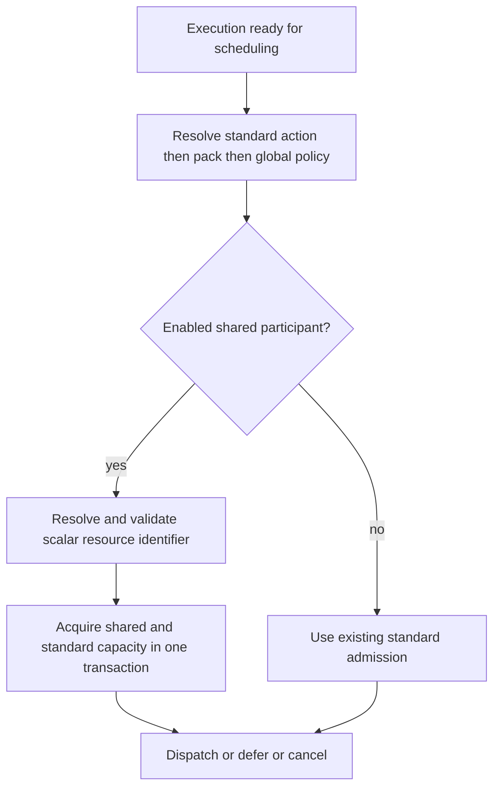

Policies control whether and when an execution may enter scheduling. They apply at global, pack, or action scope and can combine concurrency control, a rolling rate limit, and resource quotas in one row. Policies are execution controls, not RBAC grants: authorization decides who may request work, while policy enforcement limits admitted work.

In `0.10.0`, a policy can instead define shared resource concurrency through `resource_concurrency`. This is an additional constraint, not a replacement for standard policy selection. A shared policy has global or pack ownership, names its participating actions explicitly, and cannot contain standard controls.

## PostgreSQL representation

Scope is encoded by nullable foreign keys rather than a scope enum on the table. A row with `action` set is action-scoped. A row with `pack` set and no action is pack-scoped. A row with neither is global. The API exposes this as a `global`, `pack`, or `action` tagged scope.

| Feature | Columns | Meaning |
| --- | --- | --- |
| Precedence | `enabled`, `priority`, `created` | Selects the effective row at a given scope |
| Concurrency | `threshold`, `method`, `parameters` | Limits simultaneous action slots, optionally grouped by parameter paths |
| Shared resource concurrency | `resource_concurrency` | JSONB namespace, positive limit, exhaustion method, and participant action/path mappings |
| Rate limit | `rate_limit_max_executions`, `rate_limit_window_seconds` | Limits execution count in a rolling window |
| Quotas | `quotas` | Typed JSONB entries with `quota_type` and `limit` |
| Scope | `pack`, `pack_ref`, `action`, `action_ref` | Connects the control to global, pack, or action work |
| Metadata | `ref`, `name`, `description`, `tags` | Stable identity and presentation |

The database requires standard concurrency's `threshold` and `method` to be both null or both present. Positive-value checks apply to concurrency and rate-limit values. Every policy must configure a shared resource pool or at least one standard feature. Exhaustion methods are `enqueue` and `cancel`.

The API currently accepts only `running_executions` and `executions_total` quota types. `quotas` remains JSONB so the typed list can grow without a separate table, but route validation rejects unknown types before persistence.

## Resolution and enforcement

The repository chooses one enabled standard row within each scope, ordered by descending `priority` and then descending `created`. Shared rows are excluded from those queries. The production scheduling path checks action scope first, then pack, then global; it does not merge one standard feature from each scope. Shared membership is resolved independently and cannot be overridden by a more-specific standard policy.

Concurrency uses an execution queue manager when available. `enqueue` reserves a slot or places the execution in FIFO waiting state; `cancel` rejects the attempt when no slot is available.

`parameters` contains paths into the flat execution config. For concurrency, the executor extracts those values, sorts them into a deterministic map, and serializes the map as a group key. Executions with different group values then use separate concurrency groups. Missing paths resolve through the same extraction logic and still contribute to the key.

Rate-limit and quota functions are implemented: rate limiting counts executions inside a rolling window, and quotas count the named resource in the selected scope. The current `enforce_for_scheduling` path evaluates those features only from the enforcer's in-memory action, pack, and global policy values. `ExecutorService` constructs the enforcer with empty maps and does not load persisted rows into them. As a result, database-backed rate-limit and quota fields are exposed by the API but are not enforced by the current production constructor. Concurrency is the database-backed feature that the scheduling path resolves and enforces.

## Shared admission storage and locking

The [0.10.0 migration](https://github.com/attune-system/attune/blob/main/migrations/20261025000001_shared_resource_concurrency.sql) adds two tables alongside the existing standard admission tables:

| Table | Responsibility |
| --- | --- |
| `resource_concurrency_participant` | One enabled policy and dotted parameter path per action ref. The action-ref primary key rejects conflicting enabled membership. |
| `execution_resource_admission` | One execution-owned request containing its policy ID, resource digest, active flag, and durable FIFO order. Queued requests are not active reservations. |

The group identity is the policy ID plus the SHA-256 digest of a validated scalar's JSON representation. Different parameter names can therefore resolve to the same group. Namespace labels are metadata, not a way to merge independently created policy IDs. Missing or invalid identifiers fail admission rather than resolving to a null group.

`ExecutionAdmissionRepository::admit_shared_resource` uses a short PostgreSQL transaction, locking the execution and candidate policy. It rereads participant membership after acquiring the policy lock. If an edit moved the action to another policy, admission restarts before using the replacement policy. This prevents a blocked locking join from combining a newly updated policy with a stale participant path.

Under the policy lock, admission checks shared occupancy and FIFO order, then acquires the effective standard constraint in the same transaction. A failed shared admission acquires no standard slot, and waiting on the standard constraint leaves the shared request inactive. Policy-level locking briefly serializes admissions for different resources; running executions still have independent resource capacity.

## Shared release and recovery

A database execution-state trigger removes resource requests on `completed`, `failed`, `cancelled`, `timeout`, and `abandoned`. `canceling` retains its reservation. The execution primary key makes duplicate admission idempotent, and repeated terminal updates cannot release a second slot. Execution deletion cascades request cleanup.

Before workflow dispatch begins, reverting `scheduling` to `requested` and releasing capacity happen in one transaction through `revert_prestart_workflow`. It does not release reservations after the parent becomes `running`, when child work may already be in flight.

Standard completion and maintenance promotion cannot independently activate shared waiters. The supervisor uses `shared_resource_waiter_ready` as a recovery hint, republishes eligible requested work, and lets the executor repeat admission under locks. Eligible inactive shared requests remain recoverable after the ordinary reschedule attempt budget is exhausted. No database transaction remains open for the duration of an action, and no separate coordinator or broker is introduced.

## Ownership and lifecycle

Pack policy files create pack-scoped rows, or action-scoped rows when `action_ref` is present. The transactional loader handles them after actions exist. Pack-owned policies cascade when their pack is deleted. Action-scoped policies cascade when their target action is deleted. The API can create global rows with null pack ownership.

The policy API provides scoped list queries, CRUD operations, feature validation, and RBAC checks. The web UI has list, create, detail, and edit routes. Toggling `enabled` removes a policy from effective resolution without deleting its definition.

For shared policies, disabling removes enabled membership but preserves admitted reservations. Waiting requests drop the constraint on their next scheduling attempt. Resource-setting edits and policy deletion are blocked while requests remain active or waiting. Newly enabled policies do not retroactively reserve capacity for already dispatched work.

## Caveats

`priority` compares policies only within the scope being queried. An action policy wins over a pack policy because of scope specificity even when the pack row has a larger numeric priority.

The `PolicyScope` Rust enum includes an identity variant for internal policy-enforcer structure, but the persisted table and current policy API do not have an identity scope column or request variant. Public policy data is global, pack-scoped, or action-scoped.

Policy rows do not record individual admission decisions. The evidence for a rejected or queued execution lives in execution state, queue state, and service logs rather than a policy-history table.

Resource reservations are not external-operation fences. Recovering capacity after abandonment does not prove the prior operation stopped and does not guarantee exactly-once side effects.

See [Policy administration](/administration/policies/), [Shared resource concurrency](/administration/shared-resource-concurrency/), and the [API reference](/reference/api/).

Implementation sources: [policy migration](https://github.com/attune-system/attune/blob/main/migrations/20250101000003_identity_and_auth.sql), [Policy model](https://github.com/attune-system/attune/blob/main/crates/common/src/models.rs), [policy repository](https://github.com/attune-system/attune/blob/main/crates/common/src/repositories/action.rs), [policy DTOs](https://github.com/attune-system/attune/blob/main/crates/api/src/dto/policy.rs), [policy API routes](https://github.com/attune-system/attune/blob/main/crates/api/src/routes/policies.rs), [policy enforcer](https://github.com/attune-system/attune/blob/main/crates/executor/src/policy_enforcer.rs), [executor construction](https://github.com/attune-system/attune/blob/main/crates/executor/src/service.rs), and [policy web form](https://github.com/attune-system/attune/blob/main/web/src/components/policies/PolicyForm.tsx).
